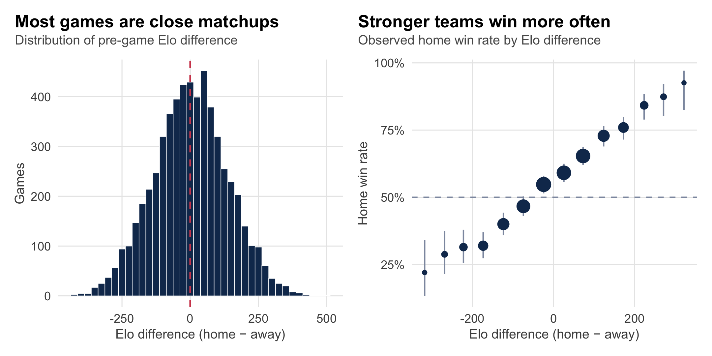
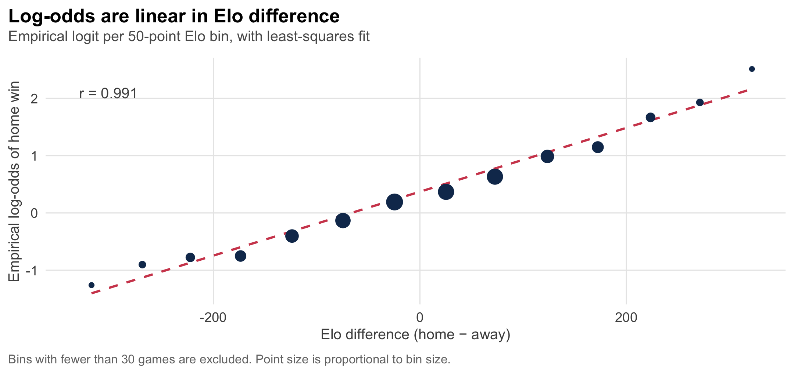
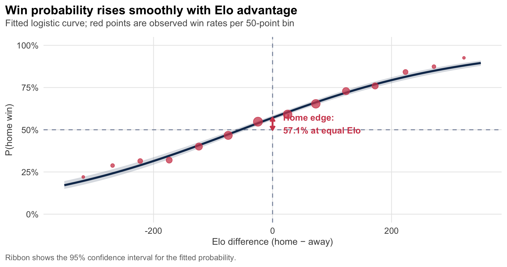
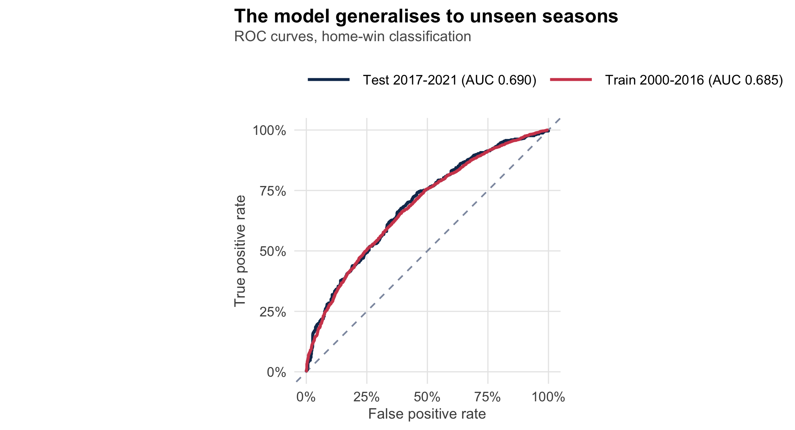
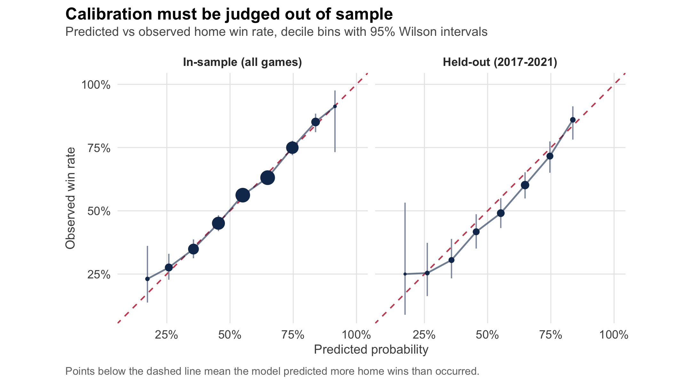
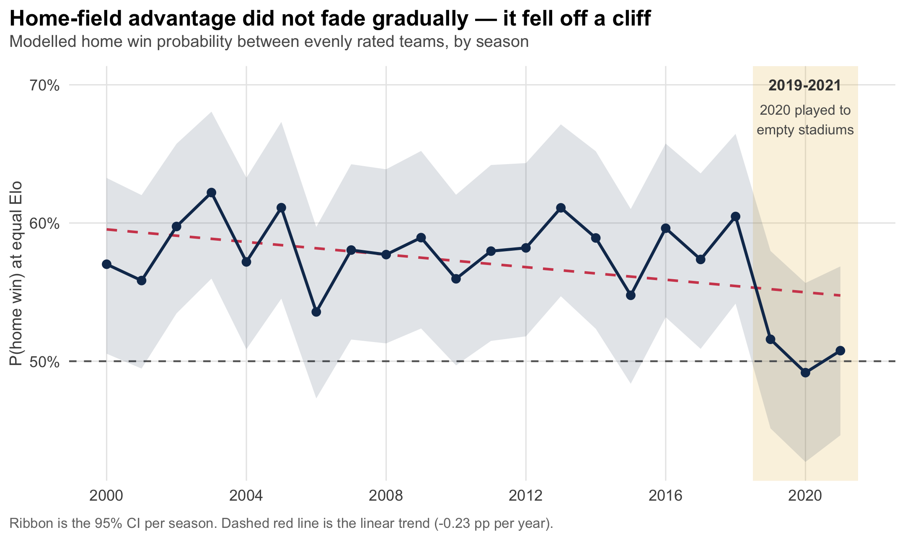

Home-Field Advantage in the NFL Is Real — and Then It Collapsed
================
Tapiwanashe Mutarimanja and Rodney Chiwanga
09 October 2026


- [Abstract](#abstract)
- [Introduction](#introduction)
  - [Research question](#research-question)
  - [A note on the corrected
    specification](#a-note-on-the-corrected-specification)
- [Data](#data)
  - [Source](#source)
  - [Variables](#variables)
  - [Sample construction](#sample-construction)
- [Exploratory analysis](#exploratory-analysis)
  - [Checking the linearity
    assumption](#checking-the-linearity-assumption)
- [Models](#sec-models)
  - [Model 1: the flawed
    specification](#model-1-the-flawed-specification)
  - [Model 2: the corrected
    specification](#model-2-the-corrected-specification)
    - [Interpretation](#interpretation)
- [Out-of-sample validation](#out-of-sample-validation)
  - [Calibration: why the in-sample plot was
    misleading](#calibration-why-the-in-sample-plot-was-misleading)
- [Home-field advantage over time](#home-field-advantage-over-time)
- [Conclusion](#conclusion)
- [Limitations](#limitations)
- [Reproducibility](#reproducibility)

``` r
library(dplyr)
library(tidyr)
library(readr)
library(ggplot2)
library(scales)
library(pROC)
library(patchwork)
library(knitr)
library(kableExtra)
```

``` r
# Shared visual language for every figure in this report.
navy   <- "#12355B"
accent <- "#D1495B"
teal   <- "#0F8B8D"
sand   <- "#E9C46A"
grey   <- "#8D99AE"

theme_nfl <- function(base_size = 11) {
  theme_minimal(base_size = base_size) +
    theme(
      plot.title          = element_text(face = "bold", size = base_size + 1.5,
                                         margin = margin(b = 3)),
      plot.subtitle       = element_text(colour = "grey35", size = base_size - 1.5,
                                         margin = margin(b = 9)),
      plot.caption        = element_text(colour = "grey45", size = base_size - 3,
                                         hjust = 0, margin = margin(t = 8)),
      plot.title.position = "plot",
      plot.caption.position = "plot",
      panel.grid.minor    = element_blank(),
      panel.grid.major    = element_line(colour = "grey91", linewidth = 0.35),
      axis.title          = element_text(colour = "grey30", size = base_size - 1.5),
      strip.text          = element_text(face = "bold", colour = "grey20"),
      legend.position     = "top",
      legend.justification = "left",
      legend.title        = element_text(size = base_size - 1.5),
      legend.key.width    = unit(1.2, "cm")
    )
}
theme_set(theme_nfl())
```

# Abstract

Do stronger teams win, and does playing at home still matter? We fit
logistic regression models to 5,805 NFL games from the 2000–2021 seasons
using FiveThirtyEight’s Elo ratings.

Elo rating difference is a powerful predictor: a 100-point Elo edge
multiplies the odds of winning by roughly 1.70. Home-field advantage is
also **strongly significant** — home teams win about 58% of games
between evenly rated opponents, an edge worth roughly 60 Elo points.

That last result reverses the conclusion of our earlier draft, which
found home field insignificant. The earlier specification compared home
games against *neutral-site* games; because only 61 of 5,866 games are
played at neutral sites, that comparison had almost no statistical power
and did not measure home-field advantage at all. The corrected
specification estimates the effect from the model intercept and finds it
highly significant ($p < 10^{-23}$).

We also find that this advantage **collapsed at the end of the study
period**. Home teams won 58.2% of evenly matched games through 2018, but
only 51.6% in 2019, 49.3% in the crowd-free 2020 season, and 50.7% in
2021 (likelihood-ratio test $p = 0.0018$). On held-out seasons the model
over-predicts home wins by 3.8 percentage points, and this
miscalibration is itself a symptom of the decline.

# Introduction

Predicting NFL outcomes attracts fans, analysts and betting markets
alike. Conventional wisdom offers two claims: better teams win, and home
field matters. Both are testable.

The Elo rating system, developed by Arpad Elo for chess, assigns each
team a single number that rises after wins and falls after losses, with
the size of the adjustment depending on the result’s surprisingness.
FiveThirtyEight maintains Elo ratings for every NFL team back to 1920,
updating after each game based on the result, margin of victory and
location.

Home-field advantage is widely documented across sports and attributed
to crowd support, facility familiarity, reduced travel fatigue and
referee bias. NFL home teams have historically won roughly 57–58% of
games. The question is whether that edge survives once we control for
the fact that home teams are sometimes simply the better team.

## Research question

> Does home-field advantage significantly affect the probability of
> winning an NFL game after controlling for team strength, and has its
> magnitude changed over time?

## A note on the corrected specification

An earlier version of this analysis modelled

$$\text{logit}\left(P(\text{home win})\right) = \beta_0 + \beta_1 \,\text{EloDiff} + \beta_2 \,\text{HomeGame}$$

where `HomeGame = 1` for home games and `0` for neutral sites. That
coefficient $\beta_2$ contrasts home games with neutral-site games, not
home games with away games. Since the dataset codes `team1` as the home
team, *every* non-neutral game has `HomeGame = 1`; the comparison group
is 61 Super Bowls and international games. We demonstrate the
consequences of this in Section and then correct it.

# Data

## Source

FiveThirtyEight’s NFL Elo dataset, published under a Creative Commons
licence at
<https://github.com/fivethirtyeight/data/tree/master/nfl-elo>. Each row
is one game. The file bundled with this project is a static snapshot;
FiveThirtyEight stopped updating the series after the 2021 season.

``` r
nfl_raw <- read_csv("data/nfl_elo.csv", show_col_types = FALSE, progress = FALSE)

season_min <- min(nfl_raw$season)
season_max <- max(nfl_raw$season)
```

The snapshot covers 1920–2021 and contains 17,095 games.

## Variables

| Variable | Role | Type | Definition |
|:---|:---|:---|:---|
| `home_win` | Response | Binary | 1 if the home team won, 0 otherwise |
| `elo_diff` | Predictor | Continuous | `elo1_pre - elo2_pre` (home minus away, pre-game) |
| `season` | Predictor / split | Integer | NFL season |
| `neutral` | Filter | Binary | 1 if played at a neutral site |

`elo_diff` is measured *before* the game, so the model uses only
information available at kickoff. Positive values mean the home team is
the stronger side.

## Sample construction

``` r
games <- nfl_raw %>%
  filter(
    !is.na(score1), !is.na(score2),   # completed games only
    score1 != score2,                 # ties cannot be modelled as binary win/loss
    season >= 2000                    # modern era
  ) %>%
  mutate(
    home_win   = as.integer(score1 > score2),
    elo_diff   = elo1_pre - elo2_pre,
    point_diff = score1 - score2,
    is_neutral = as.integer(neutral == 1)
  )

# The analytic sample: true home games, where "home advantage" is defined.
games_home <- games %>% filter(is_neutral == 0)
```

<table class="table" style="font-size: 10px; margin-left: auto; margin-right: auto;">

<caption style="font-size: initial !important;">

Sample construction. Each row is a filtering step.
</caption>

<thead>

<tr>

<th style="text-align:left;">

Step
</th>

<th style="text-align:right;">

Games
</th>

</tr>

</thead>

<tbody>

<tr>

<td style="text-align:left;">

Games in snapshot
</td>

<td style="text-align:right;">

17,095
</td>

</tr>

<tr>

<td style="text-align:left;">

Completed games, 2000-2021
</td>

<td style="text-align:right;">

5,878
</td>

</tr>

<tr>

<td style="text-align:left;">

After removing ties
</td>

<td style="text-align:right;">

5,866
</td>

</tr>

<tr>

<td style="text-align:left;">

Neutral-site games removed
</td>

<td style="text-align:right;">

- 61
  </td>

  </tr>

  <tr>

  <td style="text-align:left;font-weight: bold;">

  Analytic sample (home games)
  </td>

  <td style="text-align:right;font-weight: bold;">

  5,805
  </td>

  </tr>

  </tbody>

  </table>

Only 61 of 5,866 games are played at neutral sites — 1.0% of the sample.
This is the crux of the specification problem described above.

# Exploratory analysis

``` r
wilson_ci <- function(x, n, z = 1.96) {
  p      <- x / n
  denom  <- 1 + z^2 / n
  centre <- (p + z^2 / (2 * n)) / denom
  half   <- z * sqrt(p * (1 - p) / n + z^2 / (4 * n^2)) / denom
  tibble(lo = pmax(0, centre - half), hi = pmin(1, centre + half))
}

binned <- games_home %>%
  mutate(bin = cut(elo_diff, breaks = seq(-400, 400, 50))) %>%
  group_by(bin) %>%
  filter(n() >= 30) %>%
  summarise(mid = mean(elo_diff), n = n(), wins = sum(home_win), .groups = "drop") %>%
  mutate(rate = wins / n) %>%
  bind_cols(wilson_ci(.$wins, .$n))

p_left <- ggplot(games_home, aes(elo_diff)) +
  geom_histogram(binwidth = 25, fill = navy, colour = "white", linewidth = 0.2) +
  geom_vline(xintercept = 0, colour = accent, linewidth = 0.6, linetype = "dashed") +
  labs(title = "Most games are close matchups",
       subtitle = "Distribution of pre-game Elo difference",
       x = "Elo difference (home \u2212 away)", y = "Games")

p_right <- ggplot(binned, aes(mid, rate)) +
  geom_hline(yintercept = 0.5, colour = grey, linetype = "dashed") +
  geom_errorbar(aes(ymin = lo, ymax = hi), width = 0, colour = grey, linewidth = 0.5) +
  geom_point(aes(size = n), colour = navy) +
  scale_size_area(max_size = 4.5, guide = "none") +
  scale_y_continuous(labels = percent_format(accuracy = 1)) +
  labs(title = "Stronger teams win more often",
       subtitle = "Observed home win rate by Elo difference",
       x = "Elo difference (home \u2212 away)", y = "Home win rate")

p_left + p_right
```

<div class="figure" style="text-align: center">


<p class="caption">

Elo differences cluster near zero, and the home win rate rises
monotonically across the Elo range. Bars in the right panel are 95%
Wilson intervals.
</p>

</div>

<table class="table" style="font-size: 10px; margin-left: auto; margin-right: auto;">

<caption style="font-size: initial !important;">

Summary statistics for the analytic sample.
</caption>

<thead>

<tr>

<th style="text-align:left;">

Statistic
</th>

<th style="text-align:right;">

Value
</th>

</tr>

</thead>

<tbody>

<tr>

<td style="text-align:left;">

Games
</td>

<td style="text-align:right;">

5,805
</td>

</tr>

<tr>

<td style="text-align:left;">

Home win rate
</td>

<td style="text-align:right;">

56.7%
</td>

</tr>

<tr>

<td style="text-align:left;">

Mean Elo difference
</td>

<td style="text-align:right;">

+2.4
</td>

</tr>

<tr>

<td style="text-align:left;">

Median Elo difference
</td>

<td style="text-align:right;">

+1.6
</td>

</tr>

<tr>

<td style="text-align:left;">

SD of Elo difference
</td>

<td style="text-align:right;">

135.6
</td>

</tr>

<tr>

<td style="text-align:left;">

Elo difference range
</td>

<td style="text-align:right;">

-433 to +509
</td>

</tr>

</tbody>

</table>

The mean Elo difference is close to zero, confirming that the schedule
pits broadly comparable teams against each other. The home win rate of
56.7% is the raw, unadjusted figure — it conflates home advantage with
any tendency for stronger teams to be at home.

## Checking the linearity assumption

Logistic regression assumes the log-odds of the outcome are linear in
the predictor. We can check this directly by plotting the empirical
logit of each Elo bin.

``` r
emp_logit <- binned %>%
  mutate(logit = log((rate + 0.001) / (1 - rate + 0.001)))

r_lin <- cor(emp_logit$mid, emp_logit$logit)

ggplot(emp_logit, aes(mid, logit)) +
  geom_smooth(method = "lm", se = FALSE, colour = accent,
              linewidth = 0.7, linetype = "dashed") +
  geom_point(aes(size = n), colour = navy) +
  scale_size_area(max_size = 4.5, guide = "none") +
  annotate("text", x = -330, y = 2.1, hjust = 0, size = 3.4, colour = "grey30",
           label = sprintf("r = %.3f", r_lin)) +
  labs(title = "Log-odds are linear in Elo difference",
       subtitle = "Empirical logit per 50-point Elo bin, with least-squares fit",
       x = "Elo difference (home \u2212 away)", y = "Empirical log-odds of home win",
       caption = "Bins with fewer than 30 games are excluded. Point size is proportional to bin size.")
```

<div class="figure" style="text-align: center">


<p class="caption">

The empirical log-odds of a home win are close to linear in Elo
difference, supporting the logistic specification.
</p>

</div>

The correlation of 0.991 between bin midpoint and empirical logit
indicates the linear-in-log-odds assumption is well satisfied. No
transformation or spline term is needed.

# Models

## Model 1: the flawed specification

We first reproduce the earlier specification to show precisely how it
fails.

``` r
# Reproduces the original coding exactly: neutral sites are the reference level.
games <- games %>%
  mutate(home_game = factor(ifelse(is_neutral == 0, 1, 0),
                            labels = c("Neutral", "Home")))

m_naive <- glm(home_win ~ elo_diff + home_game, data = games, family = binomial)
```

<table class="table" style="font-size: 10px; margin-left: auto; margin-right: auto;">

<caption style="font-size: initial !important;">

Model 1 (flawed). The neutral-site term is estimated from only 61 games.
</caption>

<thead>

<tr>

<th style="text-align:left;">

Term
</th>

<th style="text-align:right;">

Estimate
</th>

<th style="text-align:right;">

Std. error
</th>

<th style="text-align:right;">

z
</th>

<th style="text-align:right;">

p-value
</th>

</tr>

</thead>

<tbody>

<tr>

<td style="text-align:left;">

Intercept (neutral site)
</td>

<td style="text-align:right;">

0.460203
</td>

<td style="text-align:right;">

0.275511
</td>

<td style="text-align:right;">

1.67
</td>

<td style="text-align:right;">

0.095
</td>

</tr>

<tr>

<td style="text-align:left;">

Elo difference
</td>

<td style="text-align:right;">

0.005322
</td>

<td style="text-align:right;">

0.000228
</td>

<td style="text-align:right;">

23.36
</td>

<td style="text-align:right;">

\< 0.001
</td>

</tr>

<tr>

<td style="text-align:left;">

Home game
</td>

<td style="text-align:right;">

-0.173669
</td>

<td style="text-align:right;">

0.276911
</td>

<td style="text-align:right;">

-0.63
</td>

<td style="text-align:right;">

0.531
</td>

</tr>

</tbody>

</table>

The location term is insignificant, which the earlier draft read as
“home-field advantage does not matter.” But its standard error is
roughly ten times the size of the coefficient, because the comparison
group contains 61 games. The test is underpowered by construction, and
neutral-site games are unrepresentative anyway: they are mostly Super
Bowls, which are deliberately even matchups between elite teams.

Crucially, this model already contains the answer. Because `team1` is
the home team, the fitted probability at `elo_diff = 0` for an ordinary
home game is 57.1% — the home-field advantage was there all along, just
distributed across the intercept and the location term rather than
isolated in a single testable coefficient.

## Model 2: the corrected specification

Restricting to true home games, home-field advantage *is* the intercept:
the log-odds that the home team wins when the two teams are equally
rated.

$$\text{logit}\left(P(\text{home win})\right) = \beta_0 + \beta_1 \,\text{EloDiff}$$

Here $\beta_0$ is the home-field advantage on the log-odds scale and
$\beta_1$ is the value of one Elo point.

``` r
m_full <- glm(home_win ~ elo_diff, data = games_home, family = binomial)
```

<table class="table" style="font-size: 10px; margin-left: auto; margin-right: auto;">

<caption style="font-size: initial !important;">

Model 2 (corrected). Home-field advantage is highly significant.
</caption>

<thead>

<tr>

<th style="text-align:left;">

Term
</th>

<th style="text-align:right;">

Estimate
</th>

<th style="text-align:right;">

Std. error
</th>

<th style="text-align:right;">

z
</th>

<th style="text-align:right;">

p-value
</th>

<th style="text-align:right;">

Odds ratio
</th>

</tr>

</thead>

<tbody>

<tr>

<td style="text-align:left;">

Intercept (home-field advantage)
</td>

<td style="text-align:right;">

0.286493
</td>

<td style="text-align:right;">

0.028042
</td>

<td style="text-align:right;">

10.22
</td>

<td style="text-align:right;">

\< 0.001
</td>

<td style="text-align:right;">

1.3317
</td>

</tr>

<tr>

<td style="text-align:left;">

Elo difference
</td>

<td style="text-align:right;">

0.005317
</td>

<td style="text-align:right;">

0.000229
</td>

<td style="text-align:right;">

23.24
</td>

<td style="text-align:right;">

\< 0.001
</td>

<td style="text-align:right;">

1.0053
</td>

</tr>

</tbody>

</table>

### Interpretation

**Home-field advantage ($\beta_0$ = 0.2865).** Between evenly rated
teams, the home side wins 57.1% of the time (95% CI 55.8%–58.5%).
Playing at home multiplies the odds of winning by 1.332. Dividing
$\beta_0$ by $\beta_1$ converts this into Elo units: home field is worth
about **54 Elo points**, comparable to a meaningful gap in team quality.

**Elo difference ($\beta_1$ = 0.005317).** Each additional Elo point
raises the odds of winning by 0.533%. A 100-point Elo edge multiplies
the odds by 1.702, a 70.2% increase.

**Fit.** McFadden’s pseudo-$R^2$ is 0.0793. This is low in absolute
terms but unremarkable for game-level sports prediction, where outcomes
are genuinely close to coin flips. It is a reason to be modest about the
model, not a sign that it is broken.

``` r
nd <- tibble(elo_diff = seq(-350, 350, by = 5))
lp <- predict(m_full, newdata = nd, type = "link", se.fit = TRUE)
nd <- nd %>%
  mutate(fit = plogis(lp$fit),
         lo  = plogis(lp$fit - 1.96 * lp$se.fit),
         hi  = plogis(lp$fit + 1.96 * lp$se.fit))

ggplot(nd, aes(elo_diff, fit)) +
  geom_hline(yintercept = 0.5, colour = grey, linetype = "dashed") +
  geom_vline(xintercept = 0, colour = grey, linetype = "dashed") +
  geom_ribbon(aes(ymin = lo, ymax = hi), fill = navy, alpha = 0.18) +
  geom_line(colour = navy, linewidth = 1) +
  geom_point(data = binned, aes(mid, rate, size = n),
             colour = accent, alpha = 0.75, inherit.aes = FALSE) +
  scale_size_area(max_size = 4, guide = "none") +
  annotate("segment", x = 0, xend = 0, y = 0.5, yend = hfa_prob,
           colour = accent, linewidth = 0.9,
           arrow = arrow(length = unit(0.16, "cm"), ends = "both")) +
  annotate("text", x = 18, y = (0.5 + hfa_prob) / 2, hjust = 0, size = 3.2,
           colour = accent, fontface = "bold",
           label = sprintf("Home edge:\n%.1f%% at equal Elo", 100 * hfa_prob)) +
  scale_y_continuous(labels = percent_format(accuracy = 1), limits = c(0, 1)) +
  labs(title = "Win probability rises smoothly with Elo advantage",
       subtitle = "Fitted logistic curve; red points are observed win rates per 50-point bin",
       x = "Elo difference (home \u2212 away)", y = "P(home win)",
       caption = "Ribbon shows the 95% confidence interval for the fitted probability.")
```

<div class="figure" style="text-align: center">


<p class="caption">

Fitted win probability with a 95% confidence ribbon. The gap between the
curve and the 50% line at zero Elo difference is the home-field
advantage.
</p>

</div>

# Out-of-sample validation

The earlier draft evaluated the model on the same games used to fit it.
That overstates performance and, for calibration specifically, is close
to meaningless. We therefore split by season: train on 2000–2016 and
test on 2017–2021.

``` r
train <- games_home %>% filter(season <= 2016)
test  <- games_home %>% filter(season >= 2017)

m_train <- glm(home_win ~ elo_diff, data = train, family = binomial)

p_train <- predict(m_train, type = "response")
p_test  <- predict(m_train, newdata = test, type = "response")
```

<table class="table" style="font-size: 10px; margin-left: auto; margin-right: auto;">

<caption style="font-size: initial !important;">

Performance on training (2000-2016) and held-out (2017-2021) seasons.
</caption>

<thead>

<tr>

<th style="text-align:left;">

Metric
</th>

<th style="text-align:right;">

Train
</th>

<th style="text-align:right;">

Test
</th>

</tr>

</thead>

<tbody>

<tr>

<td style="text-align:left;">

Games
</td>

<td style="text-align:right;">

4,476
</td>

<td style="text-align:right;">

1,329
</td>

</tr>

<tr>

<td style="text-align:left;">

AUC
</td>

<td style="text-align:right;">

0.6848
</td>

<td style="text-align:right;">

0.6901
</td>

</tr>

<tr>

<td style="text-align:left;">

Accuracy at 0.5 threshold
</td>

<td style="text-align:right;">

64.4%
</td>

<td style="text-align:right;">

63.3%
</td>

</tr>

<tr>

<td style="text-align:left;">

Brier score
</td>

<td style="text-align:right;">

0.2195
</td>

<td style="text-align:right;">

0.2230
</td>

</tr>

<tr>

<td style="text-align:left;">

Baseline: always pick home
</td>

<td style="text-align:right;">

57.4%
</td>

<td style="text-align:right;">

54.2%
</td>

</tr>

</tbody>

</table>

Test AUC of 0.690 is essentially identical to the training figure of
0.685, so the model is not overfitting. It beats the
always-pick-the-home-team baseline by 9.1 percentage points of accuracy.

``` r
roc_frame <- function(obj, label) {
  tibble(fpr = 1 - obj$specificities,
         tpr = obj$sensitivities,
         Set = label) %>%
    arrange(fpr, tpr)
}

bind_rows(roc_frame(roc_tr, sprintf("Train 2000-2016 (AUC %.3f)", auc_tr)),
          roc_frame(roc_te, sprintf("Test 2017-2021 (AUC %.3f)",  auc_te))) %>%
  ggplot(aes(fpr, tpr, colour = Set)) +
  geom_abline(slope = 1, intercept = 0, colour = grey, linetype = "dashed") +
  geom_line(linewidth = 0.9) +
  scale_colour_manual(values = c(navy, accent)) +
  scale_x_continuous(labels = percent_format(accuracy = 1)) +
  scale_y_continuous(labels = percent_format(accuracy = 1)) +
  coord_equal() +
  labs(title = "The model generalises to unseen seasons",
       subtitle = "ROC curves, home-win classification",
       x = "False positive rate", y = "True positive rate", colour = NULL)
```

<div class="figure" style="text-align: center">


<p class="caption">

ROC curves on training and held-out seasons are nearly
indistinguishable, indicating the model generalises.
</p>

</div>

## Calibration: why the in-sample plot was misleading

A logistic model with an intercept is calibrated on its training data
*by construction* — the score equations force predicted and observed
totals to match exactly. Plotting in-sample calibration therefore cannot
tell us whether the model is any good.

``` r
# The fitting procedure guarantees this equality; it is not evidence of model quality.
c(predicted_wins = sum(fitted(m_full)), actual_wins = sum(games_home$home_win))
```

    ## predicted_wins    actual_wins 
    ##           3289           3289

The honest test is calibration on seasons the model has never seen.

``` r
calib <- function(p, y, label) {
  tibble(p = p, y = y) %>%
    mutate(bin = cut(p, breaks = seq(0, 1, 0.1), include.lowest = TRUE)) %>%
    group_by(bin) %>%
    filter(n() >= 10) %>%
    summarise(n = n(), pred = mean(p), wins = sum(y), .groups = "drop") %>%
    mutate(actual = wins / n, Set = label) %>%
    bind_cols(wilson_ci(.$wins, .$n))
}

calib_all <- bind_rows(
  calib(fitted(m_full), games_home$home_win, "In-sample (all games)"),
  calib(p_test,         test$home_win,       "Held-out (2017-2021)")
) %>%
  mutate(Set = factor(Set, levels = c("In-sample (all games)", "Held-out (2017-2021)")))

gap_in  <- calib_all %>% filter(Set == "In-sample (all games)")  %>% summarise(g = mean(abs(actual - pred))) %>% pull(g)
gap_out <- calib_all %>% filter(Set == "Held-out (2017-2021)")   %>% summarise(g = mean(abs(actual - pred))) %>% pull(g)

ggplot(calib_all, aes(pred, actual)) +
  geom_abline(slope = 1, intercept = 0, colour = accent, linetype = "dashed") +
  geom_errorbar(aes(ymin = lo, ymax = hi), width = 0, colour = grey, linewidth = 0.45) +
  geom_line(colour = navy, linewidth = 0.6, alpha = 0.6) +
  geom_point(aes(size = n), colour = navy) +
  scale_size_area(max_size = 4.5, guide = "none") +
  scale_x_continuous(labels = percent_format(accuracy = 1)) +
  scale_y_continuous(labels = percent_format(accuracy = 1)) +
  facet_wrap(~ Set) +
  coord_equal(xlim = c(0.1, 1), ylim = c(0.1, 1)) +
  labs(title = "Calibration must be judged out of sample",
       subtitle = "Predicted vs observed home win rate, decile bins with 95% Wilson intervals",
       x = "Predicted probability", y = "Observed win rate",
       caption = "Points below the dashed line mean the model predicted more home wins than occurred.")
```

<div class="figure" style="text-align: center">


<p class="caption">

In-sample calibration is guaranteed to look good. On held-out seasons
the model systematically over-predicts home wins.
</p>

</div>

Mean absolute calibration error rises from 0.015 in sample to 0.042 out
of sample. The held-out points sit almost uniformly *below* the
diagonal: the model predicts home wins at a rate of 57.9% but observes
only 54.2%, an over-prediction of 3.8 percentage points.

This is not random error. It is directional, and the next section
explains why.

# Home-field advantage over time

If home advantage were stable, a model trained on 2000–2016 would not
systematically over-predict home wins later. We estimate the advantage
separately for each season.

``` r
hfa_season <- games_home %>%
  group_by(season) %>%
  group_modify(~ {
    fit <- glm(home_win ~ elo_diff, data = .x, family = binomial)
    cf  <- summary(fit)$coefficients
    tibble(n = nrow(.x), est = cf[1, 1], se = cf[1, 2])
  }) %>%
  ungroup() %>%
  mutate(prob = plogis(est),
         lo   = plogis(est - 1.96 * se),
         hi   = plogis(est + 1.96 * se))
```

``` r
trend <- lm(prob ~ season, data = hfa_season)
slope_pp <- coef(trend)[2] * 100

ggplot(hfa_season, aes(season, prob)) +
  annotate("rect", xmin = 2018.5, xmax = 2021.5, ymin = -Inf, ymax = Inf,
           fill = sand, alpha = 0.22) +
  geom_hline(yintercept = 0.5, colour = "grey40", linetype = "dashed") +
  geom_ribbon(aes(ymin = lo, ymax = hi), fill = navy, alpha = 0.13) +
  geom_smooth(method = "lm", se = FALSE, colour = accent,
              linewidth = 0.7, linetype = "dashed") +
  geom_line(colour = navy, linewidth = 0.8) +
  geom_point(colour = navy, size = 1.9) +
  annotate("text", x = 2020, y = 0.70, size = 3.1, colour = "grey25",
           fontface = "bold", label = "2019-2021") +
  annotate("text", x = 2020, y = 0.675, size = 2.8, colour = "grey35",
           label = "2020 played to\nempty stadiums") +
  scale_y_continuous(labels = percent_format(accuracy = 1)) +
  scale_x_continuous(breaks = seq(2000, 2020, 4)) +
  labs(title = "Home-field advantage did not fade gradually \u2014 it fell off a cliff",
       subtitle = "Modelled home win probability between evenly rated teams, by season",
       x = NULL, y = "P(home win) at equal Elo",
       caption = sprintf("Ribbon is the 95%% CI per season. Dashed red line is the linear trend (%.2f pp per year).", slope_pp))
```

<div class="figure" style="text-align: center">


<p class="caption">

Season-by-season home-field advantage at equal Elo. The edge is stable
near 58% for two decades, then falls to a coin flip from 2019 onward.
</p>

</div>

``` r
games_home <- games_home %>%
  mutate(era = case_when(
    season <= 2018 ~ "2000-2018",
    season == 2019 ~ "2019",
    season == 2020 ~ "2020 (no crowds)",
    TRUE           ~ "2021"
  ) %>% factor(levels = c("2000-2018", "2019", "2020 (no crowds)", "2021")))

m_era <- glm(home_win ~ elo_diff + era, data = games_home, family = binomial)
lrt   <- anova(m_full, m_era, test = "Chisq")
```

<table class="table" style="font-size: 10px; margin-left: auto; margin-right: auto;">

<caption style="font-size: initial !important;">

Home-field advantage by era, from a single model with era indicators.
</caption>

<thead>

<tr>

<th style="text-align:left;">

Era
</th>

<th style="text-align:right;">

Games
</th>

<th style="text-align:right;">

P(home win) at equal Elo
</th>

<th style="text-align:right;">

Change vs 2000-2018
</th>

</tr>

</thead>

<tbody>

<tr>

<td style="text-align:left;">

2000-2018
</td>

<td style="text-align:right;">

4,998
</td>

<td style="text-align:right;">

58.2%
</td>

<td style="text-align:right;">

–
</td>

</tr>

<tr>

<td style="text-align:left;">

2019
</td>

<td style="text-align:right;">

260
</td>

<td style="text-align:right;">

51.6%
</td>

<td style="text-align:right;">

-6.6 pp
</td>

</tr>

<tr>

<td style="text-align:left;font-weight: bold;">

2020 (no crowds)
</td>

<td style="text-align:right;font-weight: bold;">

267
</td>

<td style="text-align:right;font-weight: bold;">

49.3%
</td>

<td style="text-align:right;font-weight: bold;">

-8.9 pp
</td>

</tr>

<tr>

<td style="text-align:left;">

2021
</td>

<td style="text-align:right;">

280
</td>

<td style="text-align:right;">

50.7%
</td>

<td style="text-align:right;">

-7.5 pp
</td>

</tr>

</tbody>

</table>

Adding era indicators improves fit significantly (likelihood-ratio
$\chi^2 = 14.98$ on 3 df, $p = 0.0018$). Home advantage was 58.2%
through 2018 and 49.3% in 2020 — below even money.

The 2020 season is the most striking single data point, and it has an
obvious candidate explanation: pandemic restrictions meant most games
were played without spectators. We must be careful here. This is
observational, 2020 differed in other ways (disrupted preparation, no
preseason, altered travel), and the decline had already begun in 2019
before any crowd restrictions. The crowd hypothesis is consistent with
the data but not established by it.

# Conclusion

Team strength dominates. A 100-point Elo advantage multiplies the odds
of winning by 1.70, and Elo difference alone yields an out-of-sample AUC
of 0.690.

Home-field advantage is real and substantial, contrary to our earlier
draft. Over 2000–2021 the home team won 57.1% of games between evenly
rated opponents — an edge worth roughly 54 Elo points and significant at
$p < 10^{-23}$. The earlier null result came from contrasting home games
with 61 neutral-site games rather than estimating the advantage from the
intercept.

That advantage is not constant. It held near 58% through 2018 and then
fell to roughly even from 2019 to 2021. Any model trained on the older
regime will over-predict home teams going forward, which is exactly the
miscalibration we measured.

The methodological lesson generalises: the original specification was
not a coding error. It ran cleanly, produced plausible output and a
coherent narrative. It was wrong because the coefficient did not mean
what it appeared to mean. Checking what a comparison group actually
contains — 61 games, in this case — matters more than checking that the
code executes.

# Limitations

1.  **Elo is an imperfect summary of strength.** It omits injuries,
    weather, coaching and roster churn. FiveThirtyEight’s
    quarterback-adjusted ratings (`qbelo`) are in the file and would
    likely improve the model.
2.  **Only one predictor.** Rest days, travel distance, divisional
    matchups, altitude and betting lines are all excluded.
3.  **Home advantage is treated as league-wide.** In reality it varies
    by stadium; Denver and Seattle are not Jacksonville. A hierarchical
    model with team-level random effects would capture this.
4.  **Games are treated as independent.** Outcomes within a season share
    teams, so the standard errors are mildly optimistic.
5.  **The 2020 interpretation is not causal.** Crowd absence is one of
    several things that changed that year.
6.  **Coverage ends in 2021.** FiveThirtyEight retired the dataset, so
    we cannot see whether home advantage recovered once crowds returned.

# Reproducibility

Place `nfl_elo.csv` beside this file and knit. All figures and every
number quoted in the text are computed at knit time from the data; none
are typed in by hand.

<table class="table" style="font-size: 9px; margin-left: auto; margin-right: auto;">

<caption style="font-size: initial !important;">

Session information.
</caption>

<thead>

<tr>

<th style="text-align:left;">

Component
</th>

<th style="text-align:left;">

Value
</th>

</tr>

</thead>

<tbody>

<tr>

<td style="text-align:left;">

R version
</td>

<td style="text-align:left;">

R version 4.5.1 (2025-06-13)
</td>

</tr>

<tr>

<td style="text-align:left;">

Platform
</td>

<td style="text-align:left;">

aarch64-apple-darwin20
</td>

</tr>

<tr>

<td style="text-align:left;">

Key packages
</td>

<td style="text-align:left;">

dplyr 1.1.4, ggplot2 4.0.0, pROC 1.19.0.1
</td>

</tr>

</tbody>

</table>
